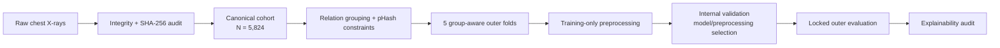

# Explainable Deep Learning for Multiclass Pediatric Pneumonia Classification

Research pipeline for pediatric chest-radiograph classification into **Normal**, **Bacterial Pneumonia**, and **Viral Pneumonia**, with explicit leakage control, reproducible preprocessing, diagnostic feature analysis, model evaluation, and explainability.

> **Research use only.** Dataset labels are research annotations and the system is not a substitute for clinical diagnosis, microbiological confirmation, or treatment decisions.

## Project at a glance

| Item | Current evidence |
|---|---:|
| Canonical readable image contents | **5,824** |
| Normal | **1,579 (27.11%)** |
| Bacterial pneumonia | **2,760 (47.39%)** |
| Viral pneumonia | **1,485 (25.50%)** |
| Filename-derived relation groups | **3,117** |
| Final leakage-control components | **2,926** |
| Unresolved pHash edges retained as split constraints | **223** |
| Outer evaluation design | **5 group-aware folds** |
| Approximate role split | **72% train / 8% internal validation / 20% outer evaluation** |

The canonical cohort contains unique readable **SHA-256 byte contents**, not 5,824 verified independent patients.

## Research pipeline



Two preprocessing branches are deliberately separated:

- **Image branch:** deterministic grayscale handling, geometry control, optional CLAHE, ImageNet-compatible representation, and training-only augmentation.
- **Metadata diagnostic branch:** a leakage-free Scikit-Learn `Pipeline`/`ColumnTransformer` fitted only on active training rows. Six numeric candidates are reduced to four retained diagnostics after rank-VIF control; metadata are **not CNN predictors**.

## Phase 2 — preprocessing and diagnostic validation

Phase 2 operationalized the Phase 1 strategy before predictive modeling.

| Diagnostic | Key result |
|---|---|
| Selected numeric candidates | 6 |
| Retained metadata outputs | **4** |
| Fold-1 rank-VIF maximum | **121.224 → 6.146** after reduction |
| Fold-1 file-size skew | **2.634 → 0.470** after `log1p` diagnostic |
| PCA retained-space variance | PC1 51.68%, PC2 24.39%, PC3 17.94%, PC4 5.98% |
| Components for ≥90% variance | **3** |
| Components for ≥95% variance | **4** |
| Phase 2 notebook execution | **16/16 cells** |
| Phase 2 unit tests | **49 passed** |

For Fold 1, the training diagnostic matrix has the explicit dimensional contract **4,191 × 6 → 4,191 × 4**. The transformation preserves row membership while removing two redundant metadata columns. The same fitted four-column schema is applied to the corresponding internal-validation and outer-evaluation roles without refitting.

### Correlation / shortcut diagnostics


Strong geometry/storage associations are treated as potential acquisition shortcuts and redundancy signals, not disease mechanisms.

## Current post-Phase-2 modeling progress

Modeling was performed **after** the Phase 2 preprocessing assignment. These results are therefore not retroactively claimed as Phase 2 evidence.

| Metric | Locked out-of-fold result |
|---|---:|
| Three-class accuracy | **81.89%** |
| Macro precision | **81.35%** |
| Macro recall / balanced accuracy | **81.25%** |
| Macro F1 | **81.30%** |
| Normal F1 | **94.97%** |
| Bacterial F1 | **83.17%** |
| Viral F1 | **65.75%** |

The dominant residual error is **Bacterial ↔ Viral** confusion. A post-hoc hierarchical reading of the same locked predictions gives **97.34% accuracy** for Normal-vs-Pneumonia and **78.23%** for Bacterial-vs-Viral discrimination.

Architecture selection retained DenseNet-121 in four folds and ConvNeXt-Tiny in one fold. The reported **81.89%** is the locked five-fold out-of-fold evaluation result; it is **not** a claimed accuracy for the later five-model deployment ensemble.

## Explainability

A locked 25-case HiResCAM audit contains:

- 5 correct Normal cases
- 5 correct Bacterial cases
- 5 correct Viral cases
- 5 Bacterial → Viral errors
- 5 Viral → Bacterial errors

All **25/25** explanations reproduced the saved evaluation probabilities. In the 10 padded G1 cases, padding occupied **27.28%** of image area on average but received **19.73%** of positive HiResCAM attribution; **0/10** cases had padding attribution exceed padding area. This weakens, but does not eliminate, padding-shortcut concerns. HiResCAM regions are model attributions, not clinically verified lesions.

## Repository map

```text
AI-Pneumonia-Project/
├── data/processed/          # audit, grouping, fold and diagnostic evidence
├── figures/                 # publication-quality diagnostics
├── phase1_strategy/         # Phase 1 strategy and audit evidence
├── phase2_implementation/   # executed notebook and IEEE report
├── src/                     # reusable pipeline / audit modules
├── tests/                   # reproducibility and integrity tests
└── requirements.txt
```

## Reproduction

From the repository root on Windows PowerShell:

```powershell
python -m venv .venv
.\.venv\Scripts\python.exe -m pip install -r requirements.txt
$env:MPLCONFIGDIR = Join-Path (Get-Location) '.mplconfig'
.\.venv\Scripts\python.exe -m unittest discover -s tests -v
```

Raw X-rays, archives, virtual environments, model checkpoints, and caches are intentionally excluded from version control. The repository stores code, derived evidence, figures, and reports needed to audit the research process.

## Reports

- [Phase 1 strategy](phase1_strategy/)
- [Phase 2 implementation](phase2_implementation/)
- [Live repository](https://github.com/Elie-Bitonda/AI-Pneumonia-Project)

## Limitations

Patient identity is not fully verified; filename relations and pHash edges are conservative leakage controls rather than confirmed patient identities. The source population may contain acquisition shortcuts. Viral pneumonia remains the most difficult class. External clinical validation has not been performed, and the deployment prototype is research software only.

## Reference

Kermany, D. S. *et al.* “Identifying Medical Diagnoses and Treatable Diseases by Image-Based Deep Learning.” *Cell*, 172(5), 1122–1131.e9, 2018. https://doi.org/10.1016/j.cell.2018.02.010
