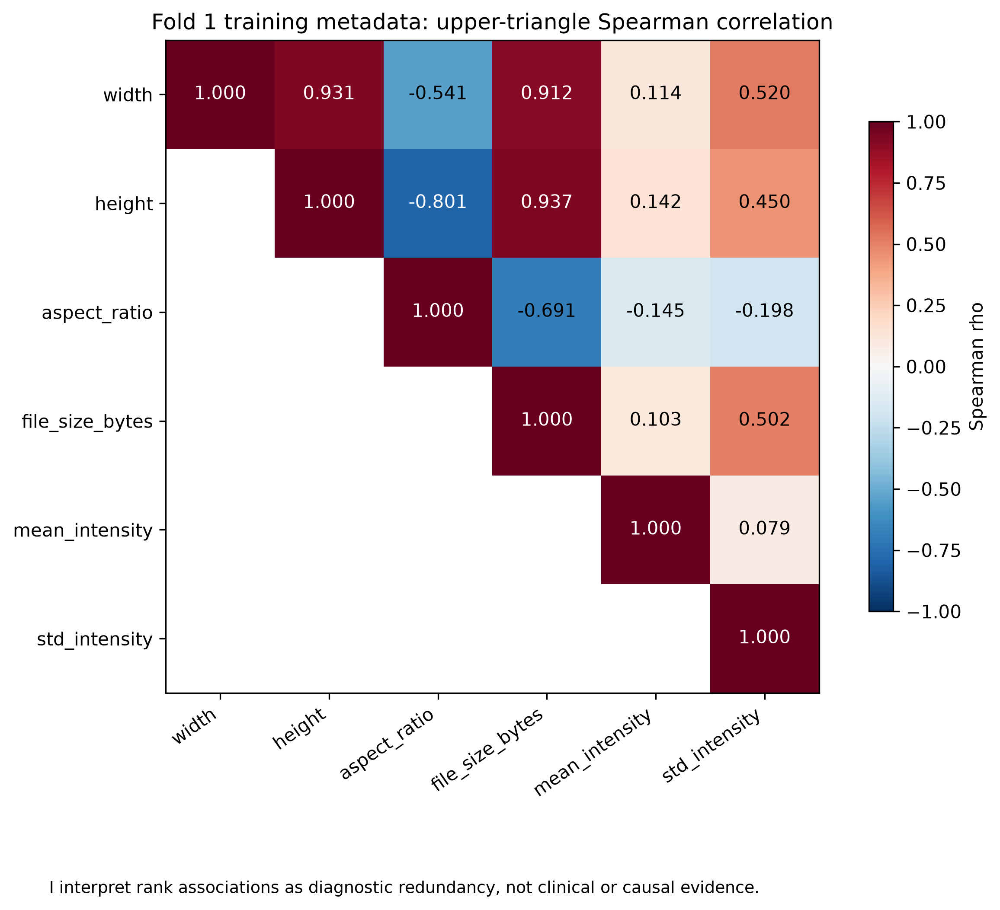
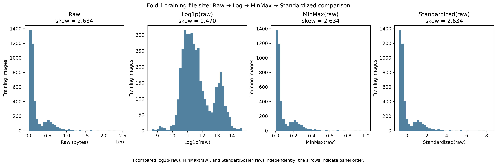
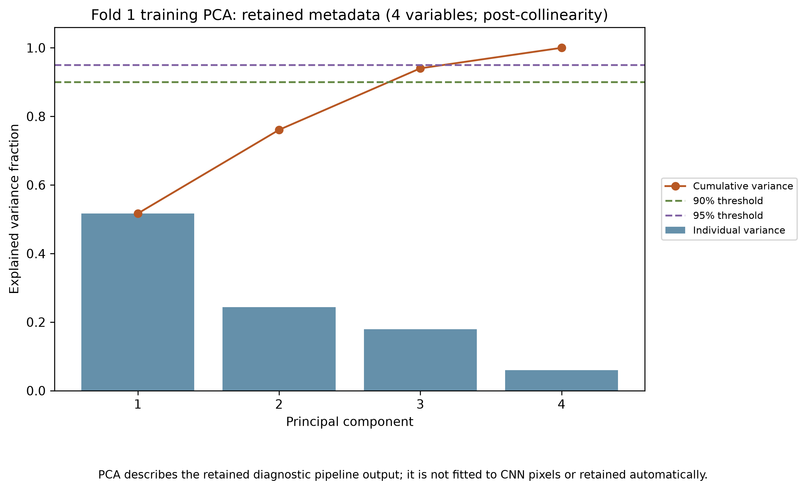
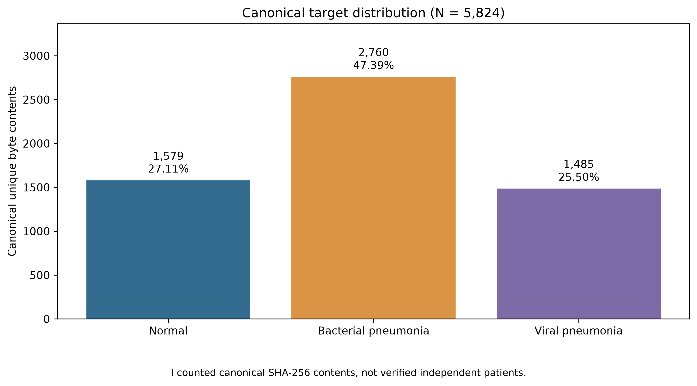
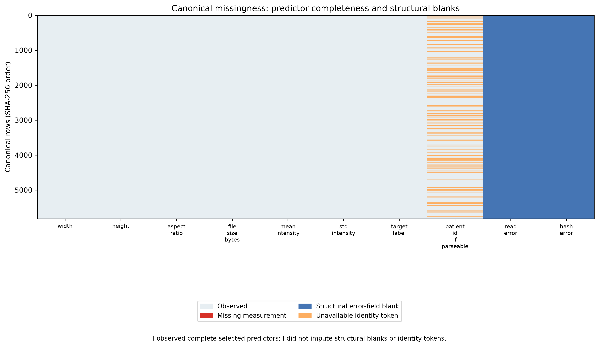
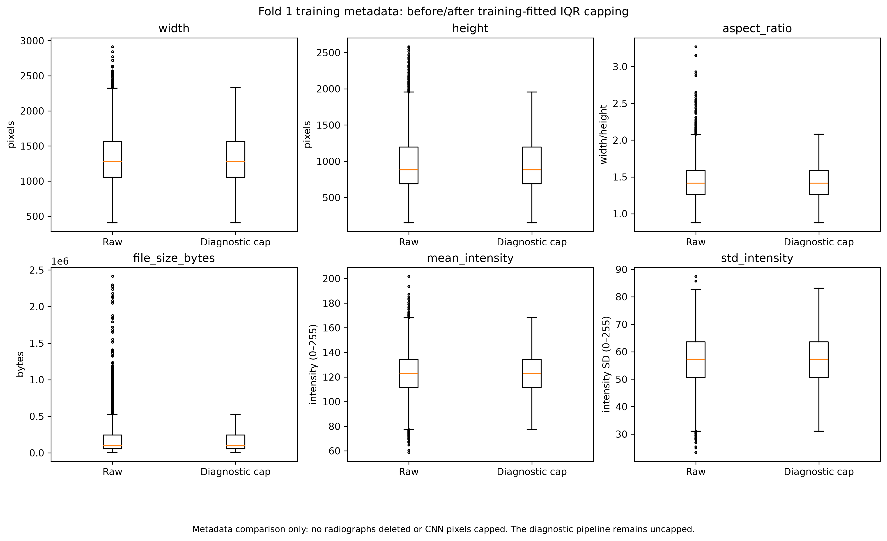
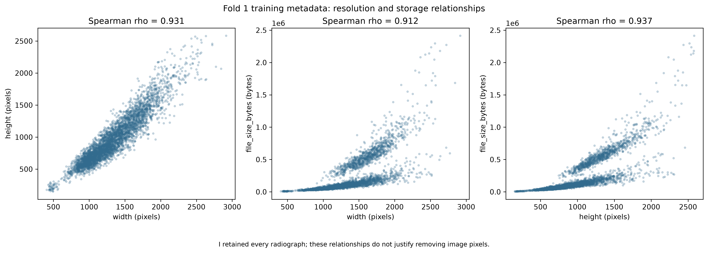
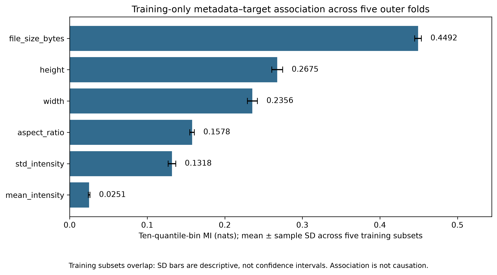

# Explainable Deep Learning for Multiclass Pediatric Pneumonia Classification

This project prepares a reliable pediatric chest X-ray pipeline for three research labels:

- **Normal** — no pneumonia label in the dataset.
- **Bacterial Pneumonia** — pneumonia cases labeled as bacterial.
- **Viral Pneumonia** — pneumonia cases labeled as viral.

These three labels are kept because the dataset already separates pneumonia into two subtypes. This gives a more useful research problem than only asking “pneumonia or not,” but it also makes the task harder because bacterial and viral cases can look similar on X-rays.

> **Research use only.** These are dataset labels and should not be treated as a clinical diagnosis.

## What Phase 2 focused on

Before training a classifier, I first checked whether the data preparation itself was trustworthy.


| Item | Phase 2 result |
|---|---:|
| Canonical readable images | **5,824** |
| Normal | **1,579 (27.11%)** |
| Bacterial | **2,760 (47.39%)** |
| Viral | **1,485 (25.50%)** |
| Relation groups | **3,117** |
| Final leakage-control components | **2,926** |
| Unresolved pHash constraints | **223** |
| Notebook execution | **16/16 code cells** |
| Phase 2 tests | **30/30 passed** |

The 5,824 images are unique readable **SHA-256 contents**. They should not be interpreted as 5,824 confirmed independent patients.

## Why the pipeline changed

Phase 2 was useful because some simple choices from the beginning were not strong enough once the data were inspected more carefully.

### 1. I did not trust the original train/test folders

Images that are related can appear in different source folders. Using those folders directly could therefore make evaluation look better than it really is.

**Decision:** use group-aware folds and keep related images in the same role.

| Fold | Train | Validation | Outer evaluation |
|---:|---:|---:|---:|
| 1 | 4,191 | 468 | 1,165 |
| 2 | 4,192 | 466 | 1,166 |
| 3 | 4,195 | 466 | 1,163 |
| 4 | 4,192 | 466 | 1,166 |
| 5 | 4,194 | 466 | 1,164 |

### 2. I did not use metadata as model inputs

Width, height, aspect ratio, and file size are strongly related. They may describe how an image was stored or acquired rather than what disease is present.



For Fold 1, the maximum rank-VIF dropped from **121.224 to 6.146** after removing redundant metadata.

The diagnostic matrix changed from:

[
4{,}191 \times 6 \rightarrow 4{,}191 \times 4
]

The retained variables are:

- width
- file size
- mean intensity
- intensity standard deviation

These variables are used for **diagnostics only**, not as CNN predictors.

### 3. I did not automatically delete outliers

An unusual X-ray is not automatically a bad X-ray. Removing every statistical outlier could remove valid clinical variation.

**Decision:** flag unusual metadata for inspection, but do not delete images only because they fall outside an IQR boundary.

### 4. I preferred Spearman correlation over Pearson

The metadata are not normally distributed and several variables are strongly skewed.

**Decision:** use **Spearman correlation**, which is more suitable for monotonic relationships in this setting.

### 5. A transformation can look better without being necessary

File-size skewness in Fold 1 changed from **2.634 to 0.470** after a diagnostic `log1p` transformation.



This shows that the transformation reduces skew, but that alone is not enough reason to force it into the final image pipeline.

### 6. PCA was used to understand the data, not to force compression



For the four retained metadata variables:

| Component | Variance explained |
|---|---:|
| PC1 | **51.68%** |
| PC2 | **24.39%** |
| PC3 | **17.94%** |
| PC4 | **5.98%** |

Three components explain more than **90%** of the variance, while all four are needed to exceed **95%**.

Because this branch is diagnostic and already small, PCA was not automatically added to the final preprocessing pipeline.

## Class balance



Bacterial pneumonia is the largest class, while Viral and Normal are smaller. This matters because a model could appear good overall while still performing poorly on one class.

For that reason, later model evaluation should not rely on accuracy alone.

## Which metrics matter and why

For the later classifier, I will report several metrics because each answers a different question:

| Metric | Why it matters here |
|---|---|
| **Recall / Sensitivity** | Shows how many true cases of a class are found. Important when missing pneumonia is costly. |
| **Precision** | Shows how often a predicted class is actually correct. Important when making a specific bacterial or viral prediction. |
| **F1-score** | Balances precision and recall. Useful when neither type of error should dominate. |
| **Macro F1** | Gives Normal, Bacterial, and Viral equal importance even though the classes are imbalanced. |
| **Balanced Accuracy** | Prevents the largest class from dominating the overall score. |
| **Confusion Matrix** | Shows exactly which classes are being confused. |

### Precision or recall?

For **Normal vs Pneumonia**, I would give more attention to **recall for pneumonia**, because missing a pneumonia case is more serious than sending an extra case for further review.

For **Bacterial vs Viral**, I would not optimize only recall or only precision. A wrong subtype prediction can also be misleading, so I would look at **both precision and recall**, together with macro F1 and the confusion matrix.

The goal is therefore not to find one impressive number, but to understand **what type of mistakes the model makes**.

## Other things that still matter

A good result should also consider:

- **class imbalance** — bacterial cases are more common;
- **data leakage** — related images must not cross train/evaluation roles;
- **shortcut learning** — the model should not rely mainly on borders, padding, image size, or storage artifacts;
- **uncertainty** — close predictions should be treated differently from very confident ones;
- **external validation** — good performance on this dataset does not prove performance in another hospital;
- **explainability** — model attention should be checked, but heatmaps are not clinical proof of disease location.

## Phase 2 visual summary

<p align="center">
  
  
</p>

<p align="center">
  
  
</p>

The full diagnostic set is available in [`figures/`](figures/).

## Current Phase 2 update

Phase 2 now has a complete preprocessing and diagnostic workflow. The canonical dataset is fixed, the leakage-safe folds are defined, the image and metadata branches are separated, the main statistical checks are saved as figures and tables, and the notebook and tests run successfully.

This gives a stable starting point for model development because the data preparation decisions are now recorded and can be reproduced.

## Repository

```text
AI-Pneumonia-Project/
├── data/processed/          # fold, grouping and diagnostic evidence
├── figures/                 # Phase 2 figures
├── phase1_strategy/         # original research strategy
├── phase2_implementation/
│   ├── notebooks/           # executed pipeline notebook
│   ├── execute_notebook.py
│   └── phase2_decision_log.md
├── src/                     # Phase 2 implementation
├── tests/                   # Phase 2 tests
└── requirements.txt
```

Executed notebook: [`phase2_implementation/notebooks/pipeline_execution.ipynb`](phase2_implementation/notebooks/pipeline_execution.ipynb)

## Phase 2 report

- [Final IEEE report (PDF)](phase2_implementation/Assignment3_Phase2.pdf)
- [LaTeX source](phase2_implementation/Assignment3_Phase2.tex)

## Limitations

- Patient identities are not fully verified.
- Filename relations and pHash edges are conservative grouping rules, not confirmed patient relationships.
- Metadata patterns may come from image acquisition or storage rather than disease.
- Phase 2 validates the data and preprocessing workflow; it does not by itself establish clinical performance.

## Reference

D. S. Kermany *et al.*, “Identifying Medical Diagnoses and Treatable Diseases by Image-Based Deep Learning,” *Cell*, vol. 172, no. 5, pp. 1122–1131.e9, 2018. https://doi.org/10.1016/j.cell.2018.02.010
